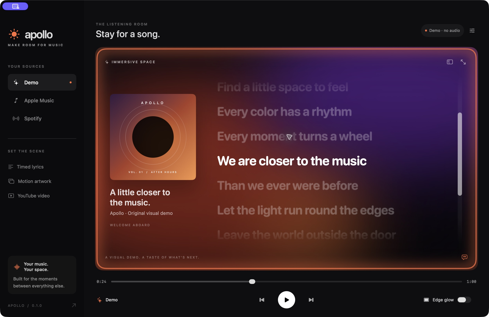

# Apollo

**Make room for music.** An open-source macOS listening room with immersive artwork, animated timed lyrics, and a glow around your displays.

Native SwiftUI + AppKit. macOS 14+. No third-party dependencies. MIT licensed.



> **0.2 developer preview.** A working foundation, not a production release or an official integration with Apple, Spotify, YouTube, Artworky, Verci, or Lumn. Inspired by the idea of bringing artwork, lyrics, and ambient lighting into one app; implemented with original code and visuals.

## What works

| Feature | Implementation |
| --- | --- |
| Apple Music desktop connection | Current song, artist, album, position, artwork where supplied by Music, playback controls via macOS Automation |
| Spotify desktop connection | Current song, artwork URL, playback position and controls via its scripting interface; no API key needed |
| Animated lyrics | Import UTF-8 `.lrc` files; timestamp-based highlighting and scrolling, click a line to seek, ±10 s timing correction |
| Immersive artwork | Artwork-backed ambient scene, fullscreen window, and muted looping local video imports |
| Display edge glow | Click-through panels on all attached displays; desktop/Spaces support; adjustable intensity |
| YouTube companion | Paste a video URL into settings; official, user-initiated embedded player beside lyrics |
| Local library | Lyrics, timing adjustments and copied video artwork associated with each track on your Mac |
| Demo | Original sample lyrics and visual scene; no account or audio needed |

## Run

An Apple Silicon developer-preview ZIP is available under [Releases](https://github.com/jkw16/Apollo/releases). It is ad-hoc signed, not notarized; building from source is recommended for development. Intel users should build from source (Intel execution has not been verified).

Install Xcode or Apple’s Command Line Tools with Swift 5.9 or later.

```sh
git clone https://github.com/jkw16/Apollo.git
cd Apollo
swift test
bash scripts/build-app.sh
open dist/Apollo.app
```

The script builds for your Mac’s architecture, creates an ad-hoc-signed application and a ZIP. This is **not notarized**. For distribution beyond a developer preview, build/sign with your own Developer ID, notarize, and staple. Do not disable Gatekeeper system-wide.

You can open `Package.swift` in Xcode for development. Use the bundled `.app` for Automation testing so macOS sees Apollo’s usage description and identity.

## First listening session

1. Try **Demo**. It is a silent visual preview, not a song stream.
2. Select **Apple Music** in Apollo to open its setup panel, then click **Connect Apple Music**. Apollo opens Music for you. For Spotify, select **Spotify** and click **Connect**.
3. Choose **OK / Allow** on the macOS Automation prompt, play a song in Music, and return to Apollo. No Apple account credentials are entered in Apollo. If permission was denied, click **Automation Settings…**, enable **Music** under **Apollo**, and click **Try Again**. A successful connection with no active track asks you to play a song. Click **Apple Music** again any time to reopen the guide.
4. Import a `.lrc` file for the playing track. Lyrics are not downloaded automatically.
5. Optionally import local motion artwork, enable **Edge glow**, and enter fullscreen with **⌃⌘F**.
6. To show YouTube, open settings and paste a video link. Click Play inside the player. Music and YouTube have independent audio/transport; mute one using its own controls if needed.

Shortcuts: **⌘P** play/pause, **⌘← / ⌘→** previous/next, **⇧⌘L** import lyrics, **⇧⌘I** import video. The menu bar icon also controls playback and glow. Quit Apollo to remove its overlays.

### Timed lyrics

Click **Timed lyrics** in the sidebar to open the customization popover. It includes:

- **Style:** Ship (flat scrolling), Fisheye (distance-based scaling), Visual (soft focus/fading with contextual emoji popups), and Fisheye Visual (scaling, soft focus, and emoji popups). When a line becomes active, its emoji pops up independently in the upper-right of the lyric viewport, drifts, and fades after 2.7 seconds. Emojis never sit in the lyric rows or scroll with the text. Ship and Fisheye have no emoji effects.
- **Font:** SF Pro, SF Rounded, New York, Helvetica Neue, Avenir Next, Futura, and Didot, with live typeface previews.
- **Text Size:** 20–60 points, with a reset to 33 points. Compact and immersive presentations scale relative to this value.
- **Keep Screen Awake:** prevents display idle sleep only while music is playing and lyrics are visible. Pausing, hiding lyrics, or switching it off releases the assertion. It does not override manual sleep or lock.
- **Non-lockscreen Visibility:** shows a click-through floating lyric panel when Apollo is in the background. It hides when Apollo returns to the foreground; no lock-screen injection is used.
- **Display:** chooses the floating lyric display and moves Apollo's normal window to that screen. “Follow Apollo” follows the main window's screen. Disconnected displays fall back to the current screen.
- **Color:** Auto Sync samples the current artwork (Apollo orange fallback). Manual Lyric Text colors past lines, Highlight colors the current line, and Secondary Text colors upcoming lines. Picking a manual color turns off Auto Sync; Reset Colors restores the original palette.
- **Import Timed Lyrics…:** opens the LRC file picker from the bottom of the popover. The existing keyboard shortcut and general settings import button still work.

Preferences are stored locally in Apollo's macOS defaults and restored after relaunch. The same appearance is used in the listening room, YouTube companion, and floating lyrics. The menu scrolls on smaller screens; Reduce Motion disables lyric blur and animated scrolling.

Visual styles match emoji imagery locally from the current lyric line, then the song title and artist metadata, with a neutral music-note fallback. Specific phrases (such as “broken heart” or “no more tears”) take priority over single words. The initial matcher includes English and Spanish cues; it is a deterministic text heuristic, not AI understanding or audio analysis, and can miss metaphors, negation, or other languages. Blank instrumental lines have no emoji, original lyric text stays intact, and Reduce Motion disables the emoji animation. No lyric text is sent to an external service.

```lrc
[ar:Your artist]
[ti:Your song]
[offset:0]
[00:04.50]Your first line
[00:10.00]Your second line
[00:15.00]
[00:20.00][00:40.00]A repeated line
```

Blank timestamped lines represent instrumental passages. Timing is line-level, not word-level. Imports are stored in `~/Library/Application Support/Apollo/library.json`; movies are copied alongside it. Use files you own or have permission to display.

## Integration boundaries

- **Apple Music:** Apollo follows the desktop app through Apple Events. It does not use private endpoints, extract DRM streams, retrieve Apple’s proprietary lyrics, or download Apple’s animated covers. Motion artwork is a local import; static artwork availability depends on the current Music track. A licensed lyric/catalog provider could be added later.
- **Spotify:** the desktop adapter is a technical implementation, not a claim of platform approval. [Spotify’s developer policy](https://developer.spotify.com/policy) restricts synchronizing recordings with visual media. Assess the applicable platform terms and obtain any required permissions before distributing a Spotify audiovisual experience. Apollo does not download Spotify audio or access its internal lyrics APIs.
- **YouTube:** the [embedding requirements](https://developers.google.com/youtube/terms/required-minimum-functionality) prohibit covering the player with overlays. Apollo therefore places lyrics beside the player and preserves controls, branding and ads. It supplies its bundle ID as the HTTP Referer. Some videos disallow embedding, need login, or are region-restricted; use **Watch on YouTube** in those cases. No automatic video search or synchronization to the song is implemented.
- **Glow:** ambient animation, not audio-reactive spectrum/beat detection. No microphone or screen-recording access is requested. Reduce Motion stops ambient and ring movement.
- **Fullscreen:** local artwork fills Apollo’s fullscreen window; the edge overlay can accompany other apps. Apollo does not replace macOS’s desktop wallpaper.

## Privacy

No analytics, accounts, server, API secrets, or listening-history upload. Apple Events stay on-device. Spotify artwork is fetched from the artwork URL supplied by Spotify. YouTube connections begin only when you load a video and are subject to [Google’s privacy policy](https://policies.google.com/privacy) and [YouTube’s terms](https://www.youtube.com/t/terms). Your imported assets stay on your Mac and are not included in the repository.

## Architecture

`ApolloCore` contains deterministic LRC parsing, lyric selection, playback interpolation, and YouTube URL validation. `DesktopBridge` serializes AppleScript operations off the UI thread. `ApolloModel` owns playback, connection state, and a per-track local asset library. SwiftUI renders the listening room; AppKit handles click-through display panels; AVKit renders local video and WebKit embeds YouTube.

Tests cover timestamp fractions/offsets/repetition, seeking backwards, blank interludes, unsafe video URLs, playback interpolation, pause, and clamping. GitHub Actions tests and packages the app on macOS.

## Roadmap

- Licensed automatic lyric lookup and enhanced word-timed lyrics.
- Provider-aware rights controls and review before broader distribution.
- Artwork-derived color palettes and an optional audio-reactive engine.
- Better media management, accessibility audit, and multi-display configuration.
- Signed/notarized universal releases, hardware testing, and update delivery.

See [CONTRIBUTING.md](CONTRIBUTING.md). The MIT license covers Apollo’s code and original demo assets; third-party music, lyrics, artwork, and videos retain their own rights.
