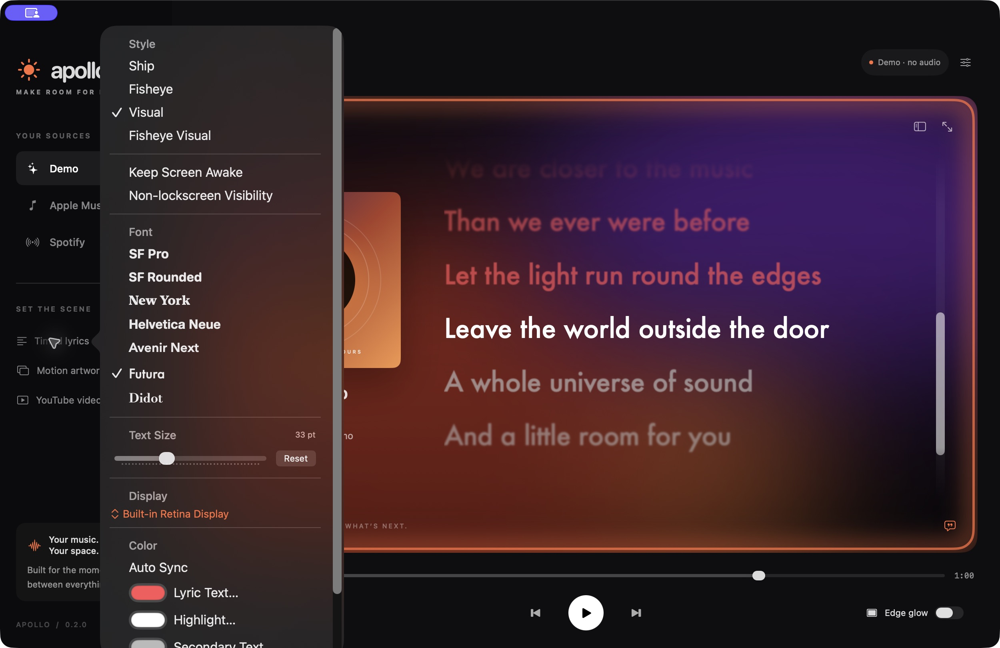

# Developer preview validation

## 0.2.2 Apple Music setup

- Added a guided connection sheet, player launch, permission recovery shortcut, retry and verified-connection status. Selecting Apple Music again reopens the guide without disconnecting.
- Seven existing core tests pass; updated release build and ad-hoc signature verification pass.
- Launched 0.2.2 and inspected the setup sheet visually and through accessibility; text and controls fit.
- Live permission approval, denial/retry, and song playback still require end-to-end validation. No user permission settings were changed during validation.

## 0.2.1 contextual emoji accents

- Seven tests pass, including lyric-first matching, metadata fallback, phrase priority, word boundaries, accented text, and blank interludes.
- Debug/release builds and packaged signature verification passed.
- Visual and Fisheye Visual share a separate viewport-anchored emoji popup layer; the original lyric rows remain text-only. Ship and Fisheye omit it. Accessibility keeps the original lyric button labels; Reduce Motion uses a brief static popup.
- Runtime verification: seeking to “Every moment turns a wheel” triggers an independent hourglass at the upper-right of the lyric viewport. It disappears after the effect duration while that lyric remains active. No emoji remains attached to a lyric row.
- Context matching uses offline English/Spanish cues, not audio or general-purpose semantic understanding. Metaphors and unsupported languages may fall back to metadata or a neutral music note.

## 0.2 lyric menu

Validated on October 13, 2026:

- Debug build, all four core tests, optimized release build, and signature verification passed.
- Timed lyrics opens a scrollable customization popover instead of an immediate file picker. Section order, font previews, checkmarks, slider, display selector, and color wells visually inspected against the supplied reference.
- Fisheye Visual and Futura selections apply live. Text-size increment updates 33 to 34 points; Reset restores 33.
- Font, style, size, Keep Screen Awake, and desktop visibility selections survive an app restart.
- macOS `pmset` confirms Apollo creates its display-sleep assertion while playing with visible lyrics and releases it on pause.
- Import Timed Lyrics opens the file picker from inside the popover; cancel returns cleanly to Apollo.
- Multi-monitor placement/hot-plug, manual color changes, artwork-derived palettes, and locked-session behavior still need broader hardware testing.

The app bundle in iCloud-synced Documents can acquire Finder metadata that invalidates its signature; runtime restart testing used the clean app from the temporary packaging directory. Release ZIPs come directly from that clean build. Install extracted apps in Applications rather than an iCloud-synced folder.

## 0.1 foundation

Validated on October 13, 2026 on an Apple Silicon Mac with Swift 6.3.3, targeting macOS 14+.

- Debug build and all four XCTest cases: passed.
- Optimized release build: passed.
- App bundle ad-hoc signature verification: passed.
- Native app launch and main window: passed.
- Demo pause and click-to-seek backwards: passed; seeking to the 24-second lyric updates the transport to 0:24 and preserves pause.
- Main interface and settings visually/accessibility inspected.
- YouTube companion renders the official Google Developers sample video player with controls beside the lyrics and can be removed. Audio/video playback after pressing Play has not yet been verified.
- Invalid video input displays an inline settings error; loading valid input clears it.
- Initial GitHub Actions macOS test/package workflow: passed.

Not yet verified end-to-end: Automation permission flows; live Apple Music/Spotify metadata, artwork and transport; imported video playback; external display hot-plugging; Intel Mac support; notarization; and third-party content licensing/platform approval. These are release gates for a production version.

The workspace’s file synchronization caused Swift to report files changed during initial builds. Copying the same source to an isolated temporary build directory allowed the debug/tests/release builds to pass.
